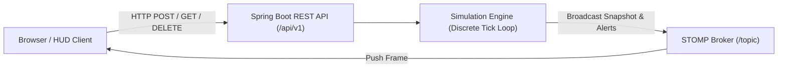

# AeroFleet — REST API & WebSocket Telemetry Documentation

This document provides complete, exhaustive API specifications for the **AeroFleet 2D Autonomous Drone Fleet Simulation Platform**.

---

## 📋 Table of Contents
1. [Architecture Overview](#1-architecture-overview)
2. [Base URL & Protocols](#2-base-url--protocols)
3. [REST Endpoints](#3-rest-endpoints)
   - [Fleet & Drone Management](#31-fleet--drone-management)
   - [Delivery Order Management](#32-delivery-order-management)
   - [Restricted Airspace (Geofencing / No-Fly Zones)](#33-restricted-airspace-geofencing--no-fly-zones)
   - [Charging Depots](#34-charging-depots)
   - [Simulation & Environment Controls](#35-simulation--environment-controls)
4. [Real-Time WebSocket (STOMP) Channels](#4-real-time-websocket-stomp-channels)
   - [Connection Handshake](#41-connection-handshake)
   - [Topic Subscriptions](#42-topic-subscriptions)
5. [Standard Error Codes & Responses](#5-standard-error-codes--responses)

---

## 1. Architecture Overview

AeroFleet exposes a dual-channel communications architecture:
- **HTTP/REST (Synchronous)**: Administrative control, mission order submission, zone definitions, drone recalls, and incident injections.
- **WebSocket / STOMP (Asynchronous)**: 1 Hz telemetry snapshots, mission status changes, and critical airspace incursion alerts streamed to client dashboards.



---

## 2. Base URL & Protocols

- **REST Base URL**: `http://localhost:8080/api/v1`
- **WebSocket Endpoint**: `http://localhost:8080/ws-telemetry` (with SockJS fallback)
- **Data Exchange Format**: `application/json; charset=UTF-8`

---

## 3. REST Endpoints

### 3.1 Fleet & Drone Management

#### `GET /api/v1/drones`
Retrieves live state for all drones in the fleet (from active memory during simulation or database fallback).

- **Response Status**: `200 OK`
- **Response Payload**: `Array<DroneDTO>`
```json
[
  {
    "id": 1,
    "callsign": "AF-ALPHA-101",
    "modelType": "QUADCOPTER_STANDARD",
    "x": 400.0,
    "y": 300.0,
    "speed": 0.0,
    "headingDegrees": 0.0,
    "batteryPercent": 100.0,
    "currentPayloadKg": 0.0,
    "status": "IDLE",
    "currentDepotId": 1,
    "assignedOrderId": null,
    "totalFlightTimeSeconds": 0,
    "totalDistanceTraveled": 0.0,
    "successfulDeliveriesCount": 0,
    "restrictedAirspaceBreach": false,
    "location": { "x": 400.0, "y": 300.0 },
    "currentWaypoint": null
  }
]
```

#### `GET /api/v1/drones/{id}`
Retrieves telemetry and flight plan status for a single specified drone.

- **Parameters**: `id` (Long, Path Variable)
- **Response Status**: `200 OK` (or `404 Not Found`)

#### `POST /api/v1/drones/{id}/recall`
Immediately aborts any active delivery mission and commands the drone to execute an emergency Return-To-Home (RTH) procedure to the nearest depot charging pad.

- **Parameters**: `id` (Long, Path Variable)
- **Response Status**: `200 OK`
- **Response Body**: `"Drone AF-ALPHA-101 recalled to nearest depot."`

---

### 3.2 Delivery Order Management

#### `GET /api/v1/orders`
Retrieves all orders. Can be filtered by lifecycle status.

- **Query Parameters**:
  - `status` (Optional, enum: `PENDING`, `ASSIGNED`, `IN_TRANSIT`, `DELIVERED`, `FAILED`, `CANCELLED`)
- **Response Status**: `200 OK`

#### `POST /api/v1/orders`
Creates a new customer delivery order on the 2D Cartesian grid. If an eligible drone is available at a depot, it is dispatched automatically on the next simulation tick.

- **Request Headers**: `Content-Type: application/json`
- **Request Body**:
```json
{
  "customerName": "Science Library",
  "deliveryX": 220.0,
  "deliveryY": 480.0,
  "packageWeightKg": 1.5,
  "priority": "MEDICAL",
  "originDepotId": 1
}
```
- **Validation Constraints**:
  - `customerName`: Not blank.
  - `deliveryX`: Float in range `[10.0, 790.0]`.
  - `deliveryY`: Float in range `[10.0, 590.0]`.
  - `packageWeightKg`: Min `0.1`, Max `15.0`.
  - `priority`: One of `STANDARD`, `HIGH`, `CRITICAL`, `MEDICAL`.
- **Response Status**: `201 Created`

#### `POST /api/v1/orders/simulate-batch?count={count}`
Generates randomized test delivery orders with varied weights and priorities scattered across the valid 2D grid area.

- **Query Parameters**: `count` (Default: `5`, Max: `20`)
- **Response Status**: `201 Created`

---

### 3.3 Restricted Airspace (Geofencing / No-Fly Zones)

#### `GET /api/v1/geofence`
Lists all registered No-Fly Zones (both active and disabled).

- **Response Status**: `200 OK`
- **Response Payload**:
```json
[
  {
    "id": 1,
    "name": "Hospital Helipad Zone",
    "centerX": 280.0,
    "centerY": 320.0,
    "radius": 55.0,
    "active": true
  }
]
```

#### `POST /api/v1/geofence`
Dynamically establishes a new circular restricted airspace zone. In-flight drones automatically adapt their paths to detour around the new zone.

- **Request Body**:
```json
{
  "name": "Construction Crane Zone",
  "centerX": 350.0,
  "centerY": 280.0,
  "radius": 45.0,
  "active": true
}
```
- **Response Status**: `201 Created`

#### `PUT /api/v1/geofence/{id}/toggle`
Toggles the active state of an existing zone (`true` $\leftrightarrow$ `false`). When activated, active flights immediately recalculate detours; when deactivated, drones take straight-line optimal paths.

- **Response Status**: `200 OK`

#### `DELETE /api/v1/geofence/{id}`
Decommissions a single zone and removes it from the airspace registry.

- **Response Status**: `204 No Content` (or `404 Not Found`)

#### `DELETE /api/v1/geofence`
Clears all restricted zones from the map (Wipe Airspace).

- **Response Status**: `204 No Content`

---

### 3.4 Charging Depots

#### `GET /api/v1/depots`
Lists all ground base stations with charging pad capacities and occupancy.

- **Response Status**: `200 OK`
- **Sample Output**:
```json
[
  {
    "id": 1,
    "name": "Central Hub Alpha",
    "x": 400.0,
    "y": 300.0,
    "chargingPadsTotal": 6,
    "chargingPadsOccupied": 3
  }
]
```

---

### 3.5 Simulation & Environment Controls

#### `GET /api/v1/simulation/status`
Returns live simulation status: running flag, time multiplier, elapsed simulation seconds, and current atmospheric conditions.

- **Response Status**: `200 OK`

#### `POST /api/v1/simulation/control`
Updates global simulation parameters in real time.

- **Request Body**:
```json
{
  "running": true,
  "speedMultiplier": 2.0,
  "weatherCondition": "WINDY",
  "windSpeedMps": 12.5,
  "windDirectionDeg": 180.0
}
```
- **Fields**:
  - `running` (Boolean): Play/pause state.
  - `speedMultiplier` (Double): Simulation speed (`0.2` to `20.0`).
  - `weatherCondition` (String): `CLEAR`, `WINDY`, `RAIN`, `STORM`.
  - `windSpeedMps` (Double): Wind velocity in m/s (`0.0` to `25.0`).
  - `windDirectionDeg` (Double): Wind origin compass heading (`0.0°` to `360.0°`).

#### `POST /api/v1/simulation/incident`
Injects simulated operational faults for testing failsafe algorithms.

- **Query Parameters**:
  - `droneId` (Long): Target drone ID.
  - `type` (String): `BATTERY_DRAIN` or `MOTOR_FAULT`.
  - `magnitude` (Double): Drain percentage (e.g. `30.0`).
- **Response Status**: `200 OK`

---

## 4. Real-Time WebSocket (STOMP) Channels

### 4.1 Connection Handshake

Connect using standard SockJS and STOMP client:
```javascript
const socket = new SockJS('/ws-telemetry');
const stompClient = Stomp.over(socket);
stompClient.connect({}, frame => {
    console.log('Connected to AeroFleet STOMP Broker');
});
```

### 4.2 Topic Subscriptions

#### 1. `/topic/telemetry`
Broadcasted once every second ($1\text{ Hz} \times \text{speedMultiplier}$).

- **Payload Schema (`FleetSnapshotDTO`)**:
```json
{
  "simulationRunning": true,
  "speedMultiplier": 1.0,
  "simTimeElapsedSeconds": 142,
  "weatherCondition": "CLEAR",
  "windSpeedMps": 4.0,
  "windDirectionDeg": 45.0,
  "totalDrones": 8,
  "activeDeliveries": 2,
  "chargingDrones": 1,
  "idleDrones": 5,
  "pendingOrders": 0,
  "completedOrders": 4,
  "drones": [
    {
      "droneId": 1,
      "callsign": "AF-ALPHA-101",
      "modelType": "QUADCOPTER_STANDARD",
      "x": 382.4,
      "y": 315.6,
      "speed": 31.5,
      "headingDegrees": 145.2,
      "batteryPercent": 92.4,
      "payloadKg": 1.2,
      "status": "EN_ROUTE_DELIVERY",
      "assignedOrderId": 101,
      "targetX": 332.4,
      "targetY": 418.2,
      "depotId": 1,
      "waypointIndex": 1,
      "totalWaypoints": 6,
      "remainingWaypoints": [
        { "x": 332.4, "y": 418.2 },
        { "x": 200.0, "y": 450.0 },
        { "x": 400.0, "y": 300.0 }
      ]
    }
  ]
}
```

#### 2. `/topic/alerts`
Pushes high-priority alerts when events occur (airspace incursions, low battery RTH, charging completion, zone established, order delivered).

- **Payload Schema (`AlertEventDTO`)**:
```json
{
  "level": "WARN",
  "title": "Flight Path Adapted",
  "message": "Drone [AF-ALPHA-101] rerouted around newly restricted airspace.",
  "droneId": 1,
  "orderId": 101,
  "timestamp": "2026-10-20T21:40:00"
}
```
*Levels*: `INFO`, `SUCCESS`, `WARN`, `DANGER`.

#### 3. `/topic/orders`
Pushes real-time order lifecycle updates when an order transitions between `PENDING` $\to$ `IN_TRANSIT` $\to$ `DELIVERED` or `FAILED`.

---

## 5. Standard Error Codes & Responses

| Code | Status | Meaning |
|---|---|---|
| `200` | OK | Request processed successfully. |
| `201` | Created | Resource successfully created. |
| `204` | No Content | Resource deleted or cleared successfully. |
| `400` | Bad Request | Validation error (e.g. coordinates out of `[10, 790]` bounds). |
| `404` | Not Found | Drone, order, or zone ID does not exist. |
| `500` | Internal Error | Unhandled server exception. |
