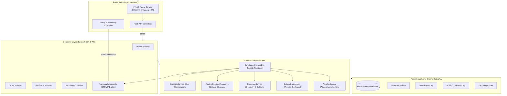
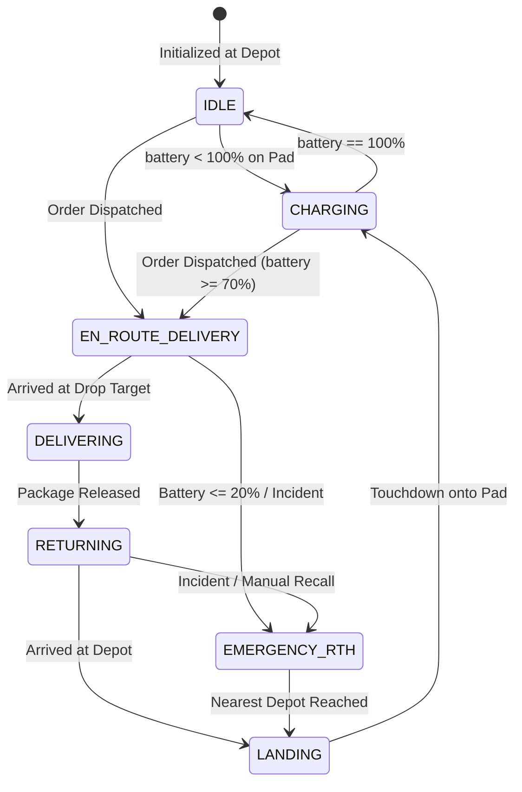
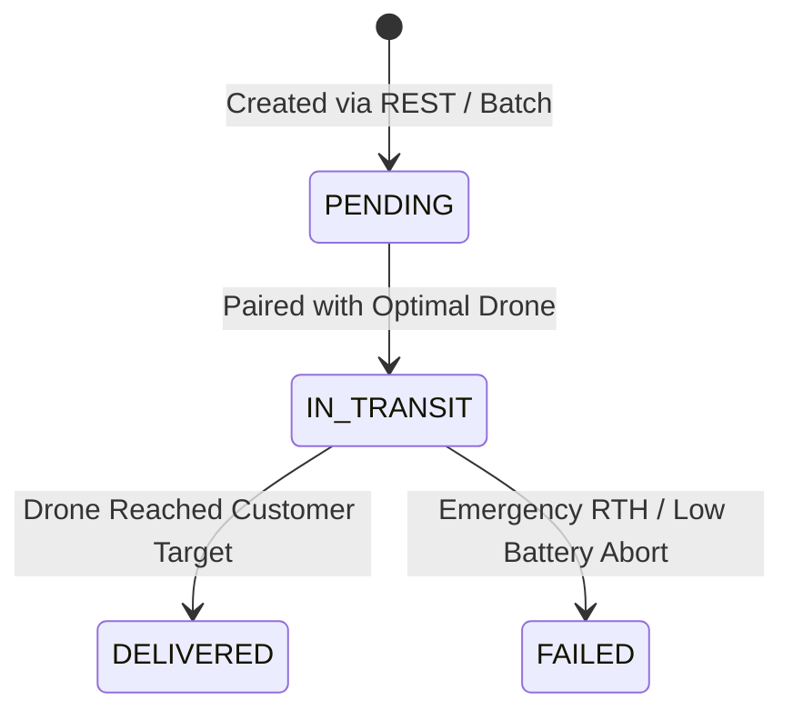
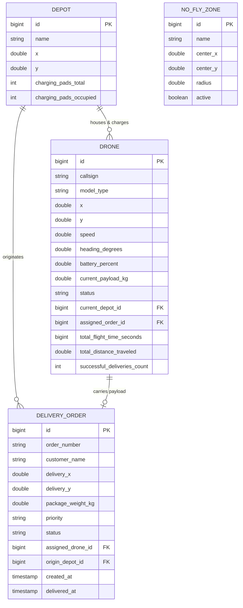
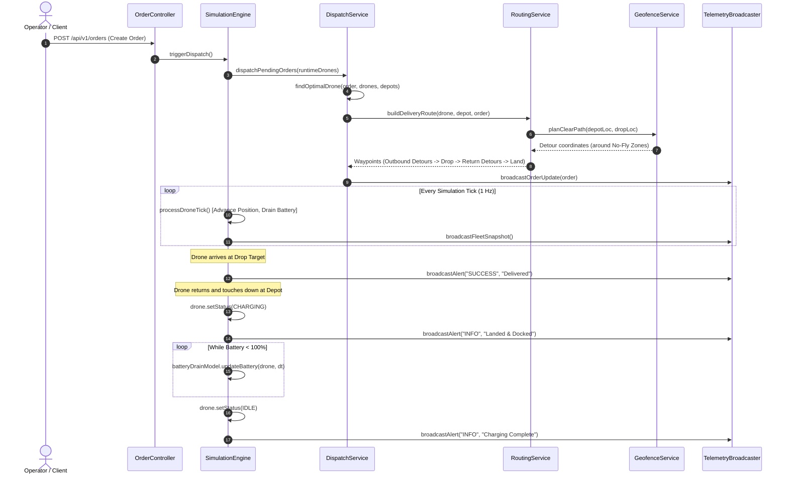

# AeroFleet — System Design & Mathematical Architecture Documentation

This document describes the architectural, mathematical, and algorithmic design of the **AeroFleet 2D Autonomous Drone Fleet Simulator**.

---

## 📋 Table of Contents
1. [System Architecture](#1-system-architecture)
2. [Mathematical & Physics Modeling](#2-mathematical--physics-modeling)
   - [2.1 Cartesian Grid Space](#21-cartesian-grid-space)
   - [2.2 Flight Kinematics & Vector Stepping](#22-flight-kinematics--vector-stepping)
   - [2.3 Atmospheric Wind Vector & Kinematic Drag](#23-atmospheric-wind-vector--kinematic-drag)
   - [2.4 Battery Energy Consumption & Pad Recharge](#24-battery-energy-consumption--pad-recharge)
   - [2.5 Exact Euclidean Line-Circle Obstacle Avoidance](#25-exact-euclidean-line-circle-obstacle-avoidance)
   - [2.6 Optimal Detour Calculation](#26-optimal-detour-calculation)
   - [2.7 Recursive Multi-Zone Route Planning](#27-recursive-multi-zone-route-planning)
3. [State Machines & Lifecycle Models](#3-state-machines--lifecycle-models)
   - [3.1 Drone Lifecycle State Machine](#31-drone-lifecycle-state-machine)
   - [3.2 Order Lifecycle State Machine](#32-order-lifecycle-state-machine)
4. [Data Model & Database Schema](#4-data-model--database-schema)
5. [Sequence Diagrams](#5-sequence-diagrams)

---

## 1. System Architecture

AeroFleet uses a layered, decoupled architecture designed according to standard object-oriented principles (OOP) without external GIS dependencies.

---

## 2. Mathematical & Physics Modeling

### 2.1 Cartesian Grid Space
The simulation operates on a bounded 2D Euclidean coordinate space:
$$\mathcal{G} = [0, 800] \times [0, 600]$$
- Standard origin $(0, 0)$ is situated at the **Top-Left** (matching standard computer graphics and canvas coordinates).
- Any location is defined as $P = (x, y)$ where $x, y \in \mathbb{R}$.

### 2.2 Flight Kinematics & Vector Stepping
For two points $P_1 = (x_1, y_1)$ and $P_2 = (x_2, y_2)$:

1. **Euclidean Distance**:
   $$d(P_1, P_2) = \sqrt{(x_2 - x_1)^2 + (y_2 - y_1)^2}$$

2. **Compass Bearing (Heading in Degrees)**:
   $$\theta = \left(\text{atan2}(y_2 - y_1, x_2 - x_1) \times \frac{180}{\pi}\right) \pmod{360}$$
   $$\theta_{\text{normalized}} = (\theta + 360) \pmod{360}$$
   - $0^\circ$ corresponds to East ($+X$), $90^\circ$ to South ($+Y$), $180^\circ$ to West ($-X$), $270^\circ$ to North ($-Y$).

3. **Incremental Translation Step**:
   Given effective speed $v$ and discrete tick time $\Delta t$, the travel distance is $\Delta d = v \cdot \Delta t$.
   If $\Delta d \ge d(P_{\text{current}}, P_{\text{target}})$, the drone snaps to the target waypoint (arrival). Otherwise:
   $$P_{\text{next}} = \left(x_1 + \frac{x_2 - x_1}{d} \cdot \Delta d, \; y_1 + \frac{y_2 - y_1}{d} \cdot \Delta d\right)$$

---

### 2.3 Atmospheric Wind Vector & Kinematic Drag
Weather is modeled with variable wind speed $w_s \in [0, 25]\text{ m/s}$ and directional heading $\theta_w \in [0^\circ, 360^\circ]$.
In meteorology, wind direction indicates where wind comes *from*. The travel direction is:
$$\theta_{\text{travel}} = (\theta_w + 180^\circ) \pmod{360^\circ}$$

The relative angle between drone heading $\theta_d$ and wind travel is $\Delta\theta = \theta_d - \theta_{\text{travel}}$.

#### Effective Ground Speed:
$$v_{\text{effective}} = \max\Big(5.0, \; v_{\text{cruise}} + \cos(\Delta\theta) \cdot (w_s \times 0.3)\Big)$$
- $\cos(\Delta\theta) = 1$ (Tailwind): Drone gains up to $+7.5\text{ units/s}$.
- $\cos(\Delta\theta) = -1$ (Headwind): Drone slows down, subject to minimum ground speed $5.0\text{ units/s}$.

---

### 2.4 Battery Energy Consumption & Pad Recharge

#### 1. In-Flight Discharge
Battery drain per second is proportional to baseline avionics, cargo payload ratio, and atmospheric drag:
$$P_{\text{drain}} = \Big(\text{BaseRate} + \text{PayloadRate} \times \frac{m_{\text{cargo}}}{m_{\text{max}}}\Big) \times \mu_{\text{drag}}$$

- $\text{BaseRate} = 0.4\%\text{ per sec}$
- $\text{PayloadRate} = 0.3\%\text{ per sec}$
- Atmospheric drag multiplier $\mu_{\text{drag}}$:
  $$\mu_{\text{drag}} = \text{ConditionBase} + \frac{w_s}{20.0}$$
  where $\text{ConditionBase} = \{1.0 \text{ (CLEAR)}, 1.3 \text{ (WINDY)}, 1.5 \text{ (RAIN)}, 2.5 \text{ (STORM)}\}$.

After elapsed time $\Delta t$:
$$\text{Battery}(t + \Delta t) = \max\Big(0.0, \; \text{Battery}(t) - (P_{\text{drain}} \cdot \Delta t)\Big)$$

#### 2. Auto-Dock Pad Recharging
When a drone is stationary at a depot charging pad (`currentDepotId != null` and $v = 0$):
$$\text{Battery}(t + \Delta t) = \min\Big(100.0, \; \text{Battery}(t) + (3.0\% \times \Delta t)\Big)$$
Once $\text{Battery} \ge 100.0\%$, status flips from `CHARGING` to `IDLE`.

---

### 2.5 Exact Euclidean Line-Circle Obstacle Avoidance

A restricted No-Fly Zone is defined by center $C = (c_x, c_y)$ and radius $R$.
A line segment connects points $A = (a_x, a_y)$ and $B = (b_x, b_y)$.

To determine whether segment $AB$ penetrates circle $(C, R)$:
Let vector $\vec{V} = B - A = (dx, dy)$ with squared length $L^2 = dx^2 + dy^2$.

The orthogonal projection of center $C$ onto infinite line $AB$ yields scalar $t$:
$$t = \frac{(c_x - a_x) \cdot dx + (c_y - a_y) \cdot dy}{L^2}$$

Clamping $t$ to the closed segment $[0, 1]$ finds the closest point on the segment $P_{\text{closest}}$:
$$t_{\text{clamped}} = \max\Big(0.0, \min(1.0, t)\Big)$$
$$P_{\text{closest}} = \Big(a_x + t_{\text{clamped}} \cdot dx, \; a_y + t_{\text{clamped}} \cdot dy\Big)$$

Intersection exists if and only if:
$$\|C - P_{\text{closest}}\|^2 = (c_x - P_x)^2 + (c_y - P_y)^2 \le R^2$$

This guarantees $O(1)$ complexity, zero missed narrow zones, and exact detection regardless of path length.

---

### 2.6 Optimal Detour Calculation

When an obstacle zone $(C, R)$ is detected along segment $AB$:
1. Compute the unit normal vectors perpendicular to path vector $\vec{V} = (dx, dy)$:
   $$\hat{n}_1 = \left(-\frac{dy}{L}, \; \frac{dx}{L}\right), \quad \hat{n}_2 = \left(\frac{dy}{L}, \; -\frac{dx}{L}\right)$$
2. Offset the bypass point outside the zone with a $35\%$ safety buffer ($d_{\text{safe}} = 1.35 \cdot R$):
   $$B_1 = C + \hat{n}_1 \cdot d_{\text{safe}}, \quad B_2 = C + \hat{n}_2 \cdot d_{\text{safe}}$$
3. Clamp both candidates within grid margins $[20, 780] \times [20, 580]$.
4. Select the candidate that avoids other active zones and minimizes total detour path length:
   $$\arg\min_{B \in \{B_1, B_2\}} \Big(d(A, B) + d(B, B')\Big)$$

---

### 2.7 Recursive Multi-Zone Route Planning

To ensure complete airspace safety when multiple zones overlap or when a detour leg intersects a secondary zone:
$$\text{planClearPath}(A, B, \text{depth}):$$
1. If $\text{depth} \ge 4$, return $[B]$.
2. Find the intersected zone $Z$ whose center is closest to $A$.
3. If no zone intersects $AB$, return $[B]$.
4. Else, calculate bypass point $B_{\text{detour}} = \text{calculateBypassWaypoint}(A, B, Z)$.
5. Return $\text{planClearPath}(A, B_{\text{detour}}, \text{depth} + 1) \; \cup \; \text{planClearPath}(B_{\text{detour}}, B, \text{depth} + 1)$.

---

## 3. State Machines & Lifecycle Models

### 3.1 Drone Lifecycle State Machine

### 3.2 Order Lifecycle State Machine

---

## 4. Data Model & Database Schema

---

## 5. Sequence Diagrams

### Order Dispatch, Airspace Avoidance, & Auto-Recharge Sequence

